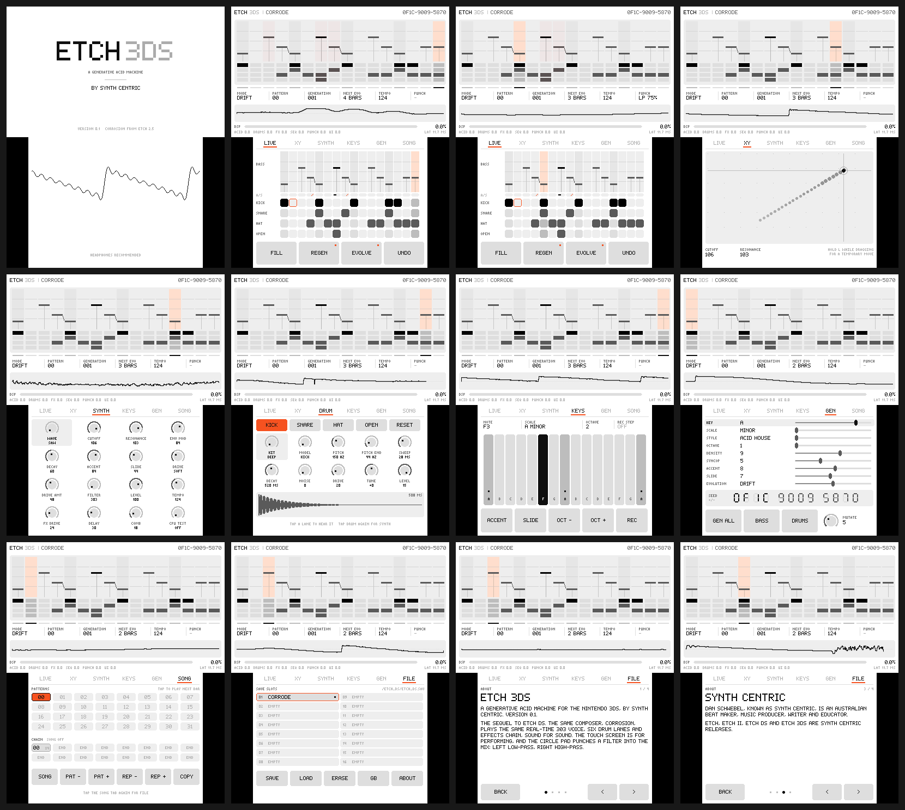
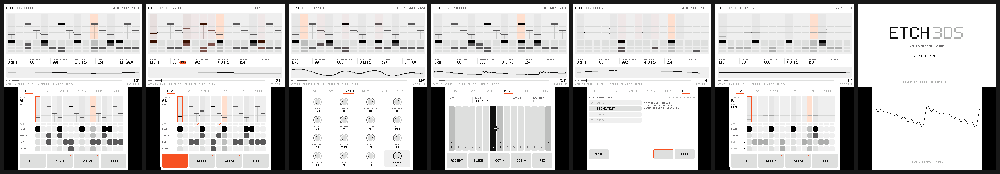

# ETCH 3DS

**A generative acid machine for the Nintendo 3DS — by Synth Centric**

ETCH 3DS is the Nintendo 3DS sequel to [ETCH DS](https://github.com/swebdan-design/ETCH-DS), which grew out of [ETCH](https://github.com/swebdan-design/Etch---GB) for the Game Boy. It keeps the same composer (CORROSION), the same seed codes, the same 303 at the centre and the same project files. The 3DS adds room to grow.

This is **milestone 1, "It squelches in 3D"**. It ports ETCH DS to the 3DS sound for sound, and proves the platform layer before any new instrument is built:

* **Press START, hear music.**
  * The title reads "ETCH 3DS", "A generative acid machine", "by Synth Centric", PRESS START.
  * START goes straight into ETCH's demo song CORRODE, composed by CORROSION from its seed code `0F1C-9009-5870` and living in DRIFT.
* **The same sound as ETCH DS, sample for sample.**
  * ETCH DS's sound engine is copied in unmodified: ACID (the 303), FOUNDRY (six drum lanes), the FX chain and the sequencer.
  * The sound engine runs in a high-priority audio thread that streams to the DSP at the DS's own 32 728.5 Hz.
  * The DS path and the 3DS path render the same bytes. That's checked on the host, with both consoles' compilers under qemu, and in the Azahar emulator.
* **PUNCH**, the first live effect: push the Circle Pad left for a resonant low-pass, or right for a high-pass.
  * It comes in on the next 16th and snaps straight back when you let go.
  * The sequencer never stops underneath.
  * A retro buffer always holds the last bar of the mix and of the drum bus on its own.
* **The ETCH DS screens, ported** to 400 × 240 (top) and 320 × 240 (touch): LIVE, XY, SYNTH/DRUM, KEYS, GEN, SONG/FILE and ABOUT, in ETCH DS's design system: black and white with the series accent **#F45423** for whatever is happening now (`docs/SERIES_SPEC.md`).
* **Saves.**
  * ETCH DS saves (versions 1 and 2) load from `/etch_ds/etch_ds.sav`, and new saves go to the same file.
  * ETCH Game Boy saves import from `/etch_ds/etch_gb.sav`, and ETCH II (Game Boy Advance) saves from `/etch_ds/etch_gba.sav`.



Running in Azahar (PUNCH low-pass, CPU test, XY, KEYS, a Game Boy song imported, the title):



The milestone report is [`docs/MILESTONE1_REPORT.md`](docs/MILESTONE1_REPORT.md), the design is in [`docs/ARCHITECTURE.md`](docs/ARCHITECTURE.md), and parked ideas are in [`docs/IDEAS.md`](docs/IDEAS.md).

## Controls

| | |
|---|---|
| START | play / stop (the moment you press it seeds the living song) |
| SELECT + LEFT / RIGHT | previous / next tab (or tap the tab bar; tap SYNTH or SONG again for its second page) |
| D-pad | move the cursor on the current tab |
| A | place or toggle |
| A + D-pad | change the value under the cursor (LIVE bass: LEFT/RIGHT a semitone, UP/DOWN an octave, as on every ETCH) |
| X / Y | on a LIVE bass note: accent / slide on or off |
| B + A | delete |
| SELECT + A | evolve at the next bar |
| SELECT + B | undo the last generation |
| SELECT + UP / DOWN | queue the next / previous pattern (song mode turns off) |
| SELECT + START | latched fill on / off |
| B (tap, on LIVE) | latched fill on / off |
| hold R | fill while held: a fresh variation every bar until you let go |
| hold L while dragging | temporary move: it springs back when you let go |
| **Circle Pad left / right** | **PUNCH: low-pass / high-pass, the further the stronger; quantised to the next 16th** |
| SELECT + START + L + R | quit |

Touch is single-point everywhere, and it is never needed for sound. The Circle Pad is never a cursor: it is for performing.

## Saves

ETCH 3DS uses ETCH DS's save file, `/etch_ds/etch_ds.sav` on the SD card: 16 slots of 16 KB in ETCH's scheme, with ETCH's Fletcher-16 checksum and the header written last.

* **Shared with the DS.** A song saved on the DS opens on the 3DS, and one saved on the 3DS opens on the DS.
* **Game Boy imports.** To import ETCH Game Boy projects, copy the cartridge's 32 KB `.sav` to `/etch_ds/etch_gb.sav`.
* **Game Boy Advance imports.** To import ETCH II projects, copy its 32 KB `.sav` to `/etch_ds/etch_gba.sav` (FILE: press GB, then GBA). The song, generator, patterns, tempo, chain and drum voicing come across; your current sound is kept.
* **3DS-only data (later milestones).** Chords, PUNCH lanes and the like will go in a sidecar file, `/etch_ds/etch_3ds.sav`, with one slot per slot of the DS file. The DS file stays exactly what ETCH DS expects.

Sound needs the DSP firmware dump that every 3DS homebrew audio app uses (`sdmc:/3ds/dspfirm.cdc`). If it's missing, run DSP1 once. Without it, the title says so and the app runs silently.

## Building

You need [devkitPro](https://devkitpro.org/)'s devkitARM with libctru (the `3ds-dev` group). The simplest route is devkitPro's Docker image:

```bash
docker run --rm -v "$PWD":/work -w /work devkitpro/devkitarm make
```

With devkitARM installed natively (`DEVKITARM` set):

```bash
make
```

This writes `etch_3ds.3dsx`. Copy it to `/3ds/` on the SD card and start it from the Homebrew Launcher. Before compiling, `make` checks that `core/` still matches ETCH DS and CORROSION byte for byte.

## Testing

The host tests need a host C compiler. The emulator runs and the analysis need Python 3 with NumPy.

```bash
make test
```

```bash
tools/arm_parity.sh
```

```bash
tools/azahar_harness/build.sh
```

```bash
python3 tools/run_azahar.py --seconds 60
```

* `make test` checks the core checksums, then runs:
  * ETCH's 44 CORROSION tests (unmodified) against the copied CORROSION
  * ETCH DS's sequencer (231), sound-engine (81) and save-file (56) tests against the copied core
  * the **sound-parity test**: the boot song and a 64-second script of edits, through ETCH DS's path and through ETCH 3DS's audio thread, PUNCH taps and all. The two must be byte-identical.
  * the PUNCH, retro-buffer and command-ring tests
  * a render of every screen

  If the ELF is built, it also runs the audio-path check.
* `tools/arm_parity.sh` compiles the parity test with the consoles' own compilers and runs both under qemu-arm. Both must write the same bytes as the host.
  * the DS build uses BlocksDS's GCC with ETCH DS's ARM9 and ARM7 flags
  * the 3DS build uses devkitARM's GCC with the ARM11 flags
* `tools/check_audio_path.py etch_3ds.elf` proves that no division, floating point, allocation or lock is reachable from the block render.
* `tools/azahar_harness/build.sh` builds a headless harness on [Azahar](https://github.com/azahar-emu/azahar)'s libretro core. That takes about an hour the first time.
* `tools/run_azahar.py` runs the `.3dsx` in that harness. Add `--stress`, `--punch`, `--tour` or `--saves` for the other scenarios, and `--model new3ds` for New 3DS.
  * It presses the buttons, moves the Circle Pad and touches the screen.
  * It records the audio and takes screenshots.
  * It reads the CPU meter, latency, dropouts and sequencer counters from emulated RAM.
  * It checks that the emulator plays exactly the samples the shared core renders on the host from the same seed. That holds up to the first evolution, where CORROSION takes the moment's entropy by design.

## Layout

```
core/          ETCH DS's shared core, unmodified and checksummed (see core/UPSTREAM)
3ds/source/    the 3DS layer: audio thread, block pump, PUNCH, graphics, input, screens
tests/host/    ETCH 3DS's host tests (parity, PUNCH, screens) and helpers
tools/         core sync and checks, audio-path checker, ARM parity, Azahar harness + runner
docs/          architecture, milestone report, ideas
```

The shared core is never edited in this repository. A change goes to ETCH-DS first and comes here with `tools/sync_core.sh`. `make ds-check DS=/path/to/ETCH-DS` proves the two still match.

## Credits

**ETCH 3DS — by Synth Centric.** Synth Centric is Dan Schwebel.

* CORROSION and ETCH's oscillator recipes come from ETCH (MIT; see `core/corrosion/LICENSE.ETCH`).
* The swing-change fix and the edit epoch come from ETCH II.
* The sound engine, sequencer and screens come from ETCH DS.

Built with devkitARM and libctru; tested with Azahar.
