# ETCH 3DS — A Generative Acid Machine

**by Synth Centric**

**User Manual — version 0.2**

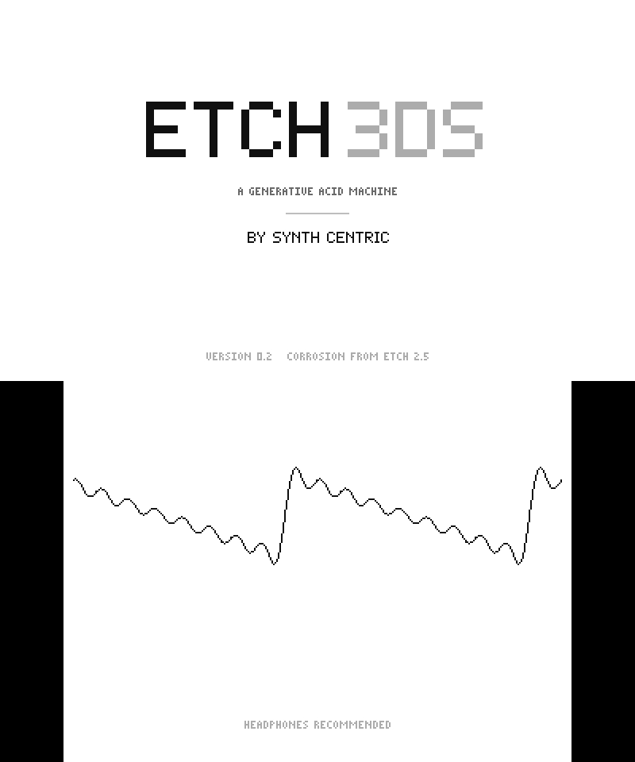

## 1. What ETCH 3DS is

ETCH 3DS turns a Nintendo 3DS into an acid machine that writes its own music. It has:

- **ACID**, a real-time 303-style bass voice: four waveforms, a resonant filter, accent, slide and drive.
- **FOUNDRY**, six drum lanes synthesised on the console, with ETCH's kits as presets and a drum designer.
- **An effects chain**: drive, bit-crush, a tempo-synced delay that degrades as it repeats, a metallic comb filter and a limiter.
- **CORROSION**, the composer. It writes a bass line and drums from a seed, and keeps rewriting them while they play.
- **PUNCH** on the Circle Pad: push it to punch a filter into the mix, live.
- **The touch screen** for performing: an XY pad, a two-octave keyboard, knobs and pads.

Every song can be shared as a 12-digit seed code. ETCH 3DS can also import songs saved with ETCH on the Game Boy and ETCH II on the Game Boy Advance (see FILE).

## 2. Quick start

1. Copy `etch_3ds.3dsx` to the `/3ds/` folder on your SD card.
2. Start it from the Homebrew Launcher. On the title screen, press **START** (or tap the screen).
3. Music starts at once: the demo song CORRODE, living in DRIFT, so it changes a little every 4 bars.
4. Push the **Circle Pad** to the left and hold it: a low-pass filter closes over the mix. Let go and it snaps back.
5. On the bottom screen, tap **XY** and drag your finger: left/right is the filter cutoff, up/down the resonance.
6. Tap **LIVE**, then tap **FILL** and **REGEN**: a drum fill, then half the bar rewritten.
7. Headphones are recommended: the speakers can't play the lowest notes.

**No sound?** ETCH 3DS plays through the 3DS's sound processor, which needs a copy of its firmware on the SD card (`/3ds/dspfirm.cdc`). Every homebrew app with sound needs it. If the title screen says "NO SOUND: DSP FIRMWARE MISSING", run the **DSP1** homebrew app once to create the file, then start ETCH 3DS again.

## 3. The two screens

**Top screen (always, 400 × 240):** the machine's face. It shows:

- the song name and the seed code
- the pattern: the bass line as pitch, plus four drum lanes
- a row of step lights
- the readouts **MODE · PATTERN · GENERATION · NEXT EVO · TEMPO · PUNCH**
- an oscilloscope
- the DSP meter

While a fill is on, a small **FILL** tag (or **HOLD**, when latched) shows beside PATTERN.

**Bottom screen (touch, 320 × 240):** six tabs, **LIVE · XY · SYNTH · KEYS · GEN · SONG**. Tap a tab, or press **SELECT + ←/→**. Tap SYNTH again for its second page, DRUM. Tap SONG again for FILE.

**The look.** Black on white, grey captions over black values, and one accent colour, orange **#F45423**, for whatever is happening now:

- the playhead
- the cursor
- the current tab
- a lit pad
- the steps CORROSION has just changed (they glow and fade over the next bars)

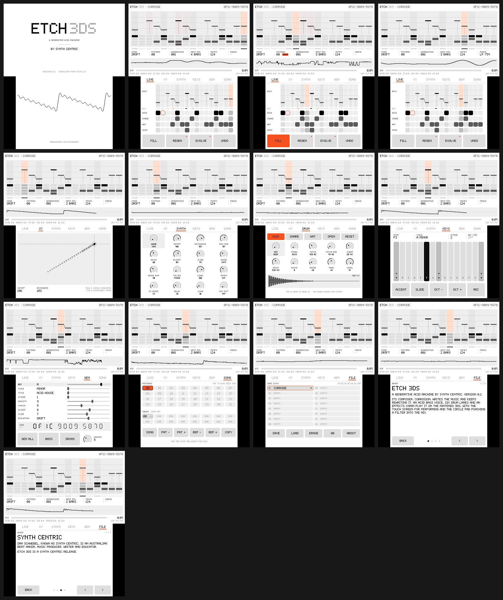

## 4. Controls

Touch is never needed for sound: everything can be done with the buttons.

### Everywhere

| Buttons | What it does |
|---|---|
| START | Play / stop. The moment you press it seeds the living song. |
| SELECT + ←/→ | Previous / next tab |
| SELECT + ↑/↓ | Queue the next / previous pattern (it switches at the bar line; song mode turns off) |
| SELECT + A | Evolve now (at the next bar) |
| SELECT + B | Undo the last evolution or generation |
| SELECT + START | Fill on / off (latched: a fresh fill every bar until you switch it off) |
| hold R | Fill while held |
| hold L while dragging | A temporary move: it springs back when you let go |
| **Circle Pad ←/→** | **PUNCH:** low-pass / high-pass, live (see below) |
| **SELECT + START + L + R** | **Quit** back to the Homebrew Launcher |

### Editing (the same on every ETCH)

| Buttons | What it does |
|---|---|
| D-pad | Move the cursor |
| A | Place or toggle (a note, a hit, a mute, a pad) |
| A + ←/→ | Value down / up. On a bass note: a semitone. |
| A + ↑/↓ | Value up / down in big steps. On a bass note: an octave. |
| B + A | Delete |
| B (tap, on LIVE) | Fill on / off |
| X / Y (on a LIVE bass note) | Accent / slide on or off |

The D-pad moves the cursor; the Circle Pad never does. The Circle Pad is only for PUNCH.

### PUNCH — the Circle Pad

Push the Circle Pad and a filter punches into the whole mix:

- **Left** is a resonant **low-pass**: the further you push, the darker and more resonant it gets.
- **Right** is a **high-pass**: the further you push, the thinner it gets.

**When it starts.** A punch starts exactly on the **next 16th note**, so it always lands in time. While you wait for that 16th, the top screen's PUNCH readout says "ON NEXT 16TH". When the music is stopped, it starts at once.

**When you let go,** the filter **snaps back** at once, smoothly and without a click. The sequencer never stops underneath, so the song is exactly where it would have been. The top screen's PUNCH readout shows LP or HP and how far you're pushing.

## 5. LIVE — the pattern, and performing

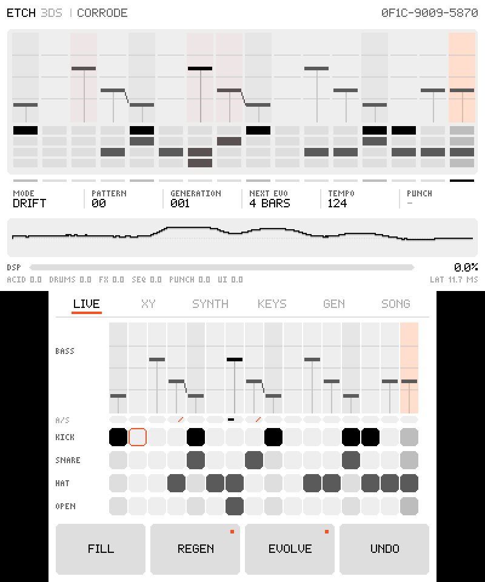

The pattern you hear, editable:

- **BASS** shows each note as a bar at its pitch.
    - Tap an empty step to place the last note you used.
    - Tap a note to make it a rest.
    - Drag up or down on a step to move it by scale steps.
    - The note's name shows beside the lane.
- **A/S** under each step: tap it to cycle accent and slide (or use X and Y on the buttons).
- **KICK · SNARE · HAT · OPEN**: tap or swipe cells to set hits. Tap a lane's name to mute it.
- **The pads:**
    - **FILL**: a drum fill
    - **REGEN**: exactly half the bar is replaced with new material in the song's key and style
    - **EVOLVE**: CORROSION mutates the pattern at the next bar
    - **UNDO**

The small dot on REGEN and EVOLVE means they rewrite music.

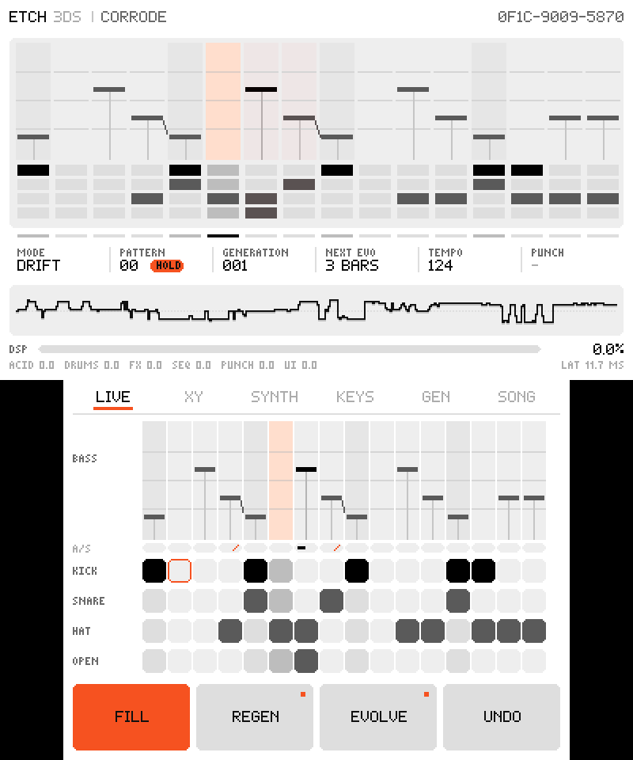

With the buttons:

- Move with the D-pad. Left of step 1 is the lane name.
- A places or toggles.
- A + ←/→ moves a bass note by a semitone, and A + ↑/↓ by an octave.
- X and Y set accent and slide.
- B + A deletes.
- B tapped on its own switches the fill on or off.

## 6. XY — the filter by hand

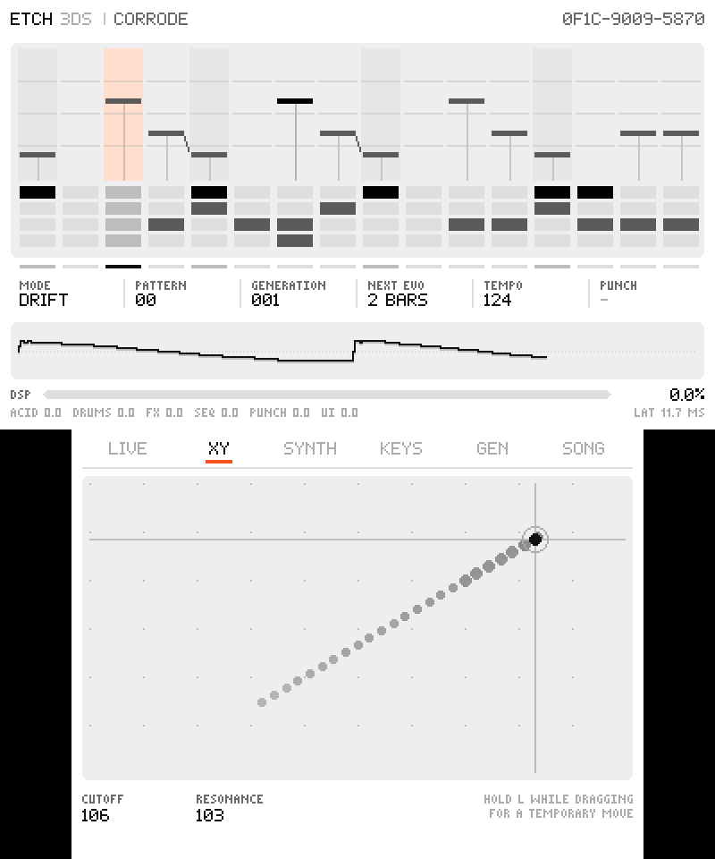

Drag anywhere: left/right sets the cutoff, up/down the resonance. A fading trail shows where you've been, and the values show at the bottom. Hold **L** while you drag for a temporary move that springs back when you let go.

## 7. SYNTH and DRUM — the sound

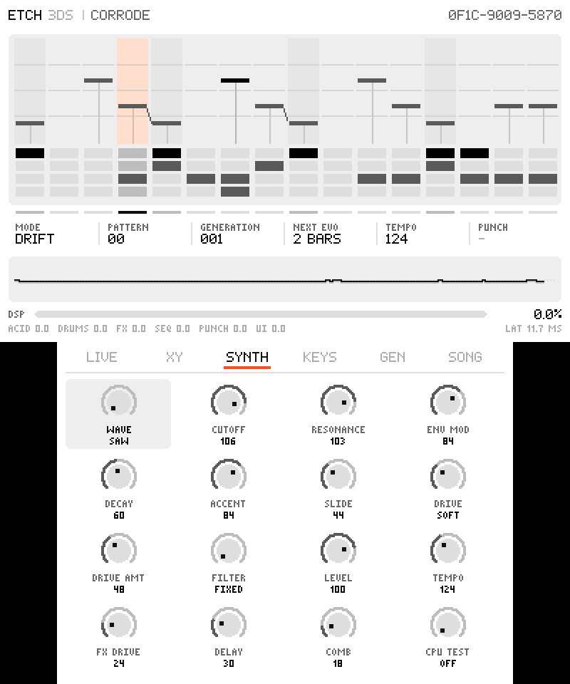

**SYNTH** is a panel of knobs. To turn a knob up, drag it up or right; the whole range is about 110 px of travel. Or select it with the D-pad and use A + ←/→.

- **ACID:**
    - wave (SAW, SQUARE, HOLLOW, BITE)
    - cutoff, resonance, env mod and decay
    - accent and slide
    - drive and drive amount
    - filter (FIXED, or KEY to follow the notes)
    - level
- **TEMPO**, and the effects: FX drive, delay and comb.
- **CPU TEST** loads the engine on purpose, to check it never drops out.

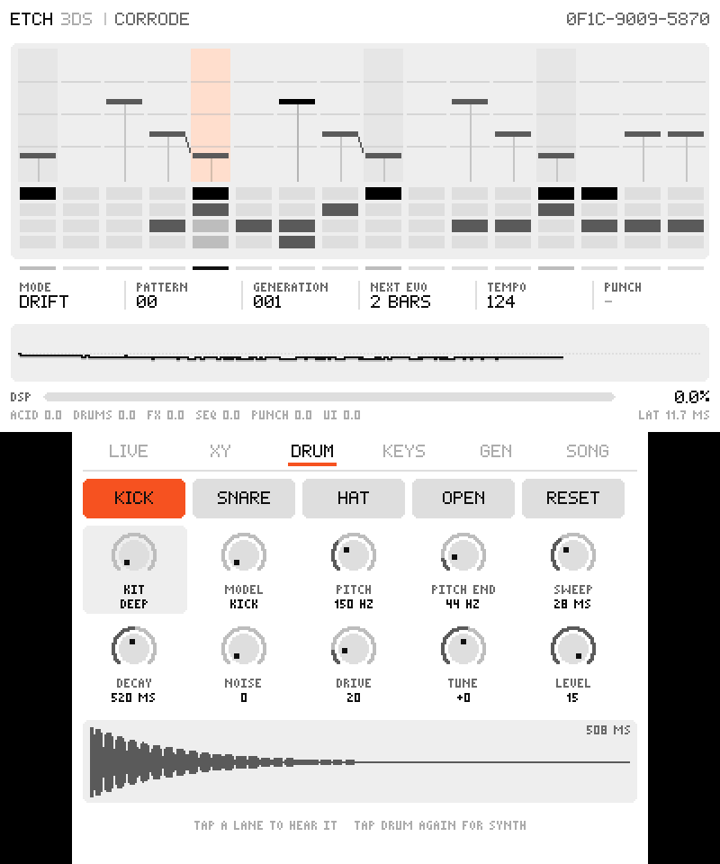

**DRUM** (tap SYNTH again) is FOUNDRY's drum designer.

1. Pick a lane. Tapping it plays it.
2. Shape the sound in the kit slot the playing pattern uses:
    - KIT
    - MODEL: kick, snare, clap, rim, hat, metal, blip, ring or crush
    - PITCH, PITCH END and SWEEP
    - DECAY, NOISE and DRIVE
    - TUNE and LEVEL

A waveform view shows the result.

- Each change re-synthesises the drum while the song plays.
- Knobs a model doesn't use are dimmed.
- RESET restores ETCH's preset.

## 8. KEYS — play the bass

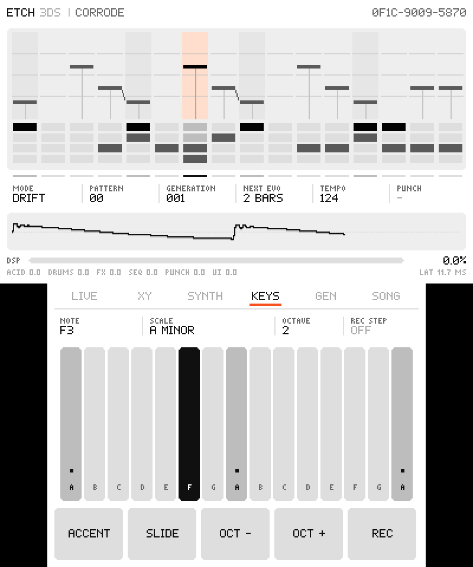

Two octaves of the song's key and scale only, so there are no wrong notes.

- **ACCENT** and **SLIDE** latch. With SLIDE on, dragging between keys glides.
- **OCT −/+** shifts the keyboard.
- **REC** records:
    - while playing, a key writes into the step that is sounding
    - while stopped, it writes step by step, and B + A writes a rest
- A held key takes the bass from the sequencer.

## 9. GEN — CORROSION, the composer

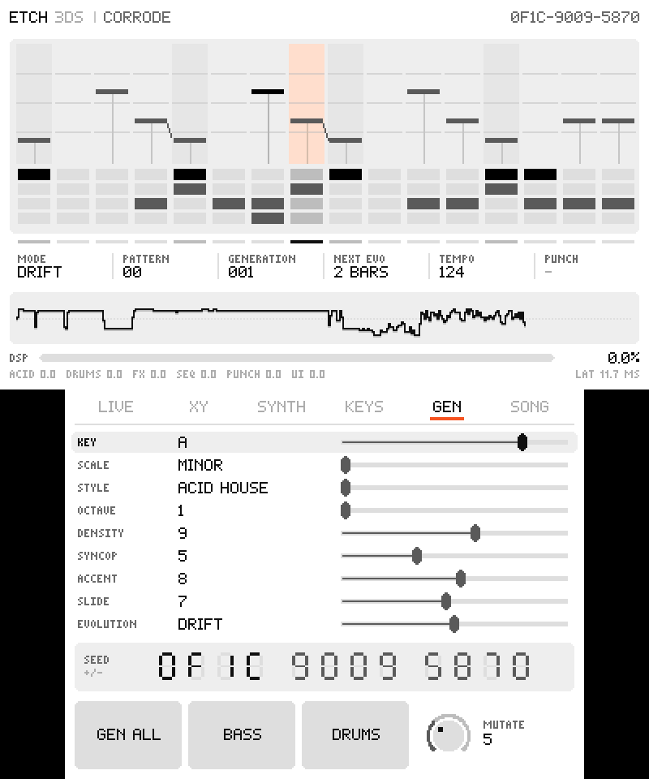

CORROSION's settings sit on faders:

- KEY, SCALE and STYLE
- OCTAVE, DENSITY and SYNCOPATION
- ACCENT and SLIDE
- the evolution MODE

The **seed code** sits on a 7-segment pad: tap above or below a digit to change it.

**GEN ALL**, **BASS** and **DRUMS** compose new material. The **MUTATE** dial sets how far evolution may wander.

### STABLE, DRIFT and CORRODE

- **STABLE:** the pattern never changes by itself.
- **DRIFT:** every 4 bars, every channel changes a little, always staying close to the original. This is a living song.
- **CORRODE:** bigger changes every 2 bars: the music keeps turning into something new.

Randomness for evolution comes from the exact timing of your button presses, starting with the moment you pressed START, so every listen is different.

### Seed codes

A code like `0F1C-9009-5870` holds CORROSION's settings and seed. The same 12 digits make the same groove on every ETCH. A 16-digit code (ETCH II's extended code) also works: ETCH 3DS uses the first 12 digits.

## 10. SONG — arrangement

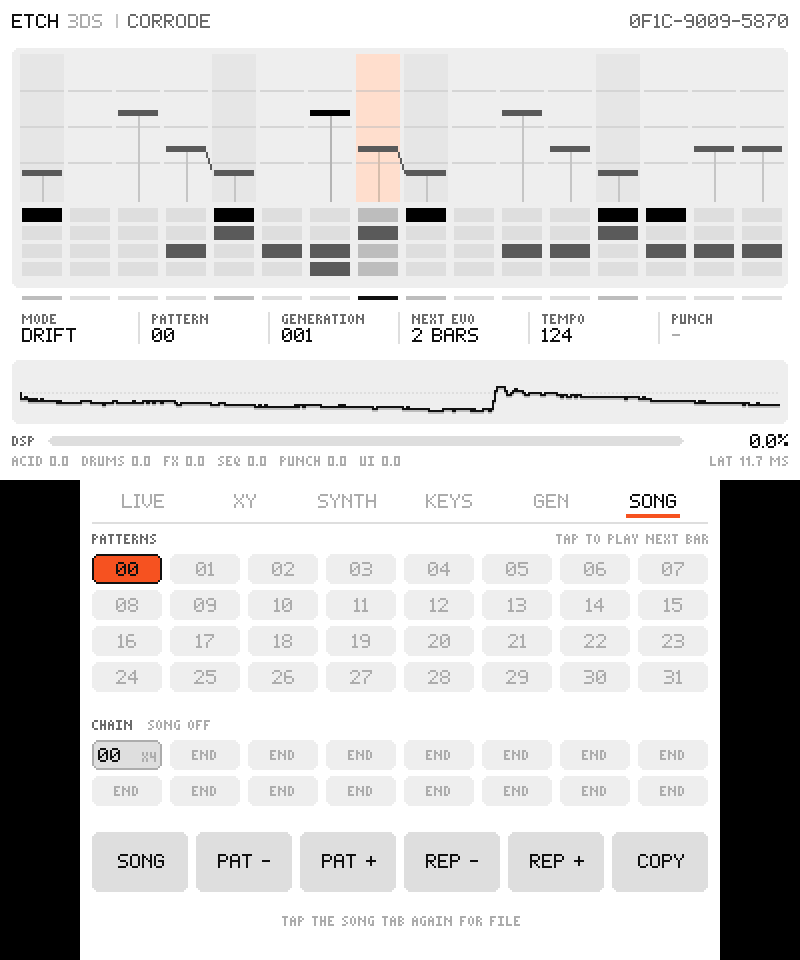

- **The 32 patterns:** tap one to play it from the next bar. With SONG on, a tap puts it in the selected chain slot instead.
- **The chain:** 16 slots, each a pattern and its repeats. Tap a slot to select it, and tap it again to jump there.
- **SONG** on/off, **PAT −/+**, **REP −/+**, and **COPY** (the playing pattern into the next empty one).

## 11. FILE — saving, loading and importing

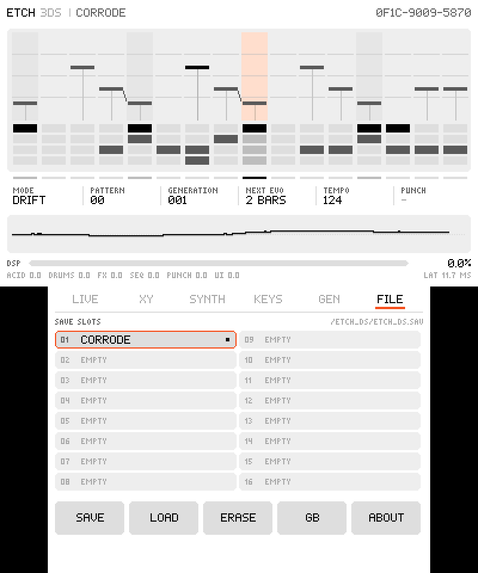

Tap SONG again for FILE.

**SAVE / LOAD / ERASE** use 16 slots on the SD card, in `/etch_ds/etch_ds.sav`.

- Loading, erasing and overwriting ask twice.
- Loading jumps to LIVE and plays.

**This save file is shared with ETCH DS.** If you also have ETCH DS on a DS flash cart, copy `etch_ds.sav` between the two SD cards. A song saved on one opens on the other, in both directions.

**GB** lists songs saved on **ETCH** for the Game Boy, to import. Copy the cartridge's 32 KB `.sav` to `/etch_ds/etch_gb.sav`.

Press the same button again (**GBA**) for songs saved on **ETCH II** for the Game Boy Advance. Copy its 32 KB `.sav` to `/etch_ds/etch_gba.sav`.

- These come across exactly: the song's name, CORROSION settings, all 32 patterns, tempo, chain and drum settings.
- ETCH II's synthesizer sounds have no equivalent here, so your current sound is kept.
- Press the button once more (**DS**) to return to your own save slots.

Imports are read only: your Game Boy and GBA saves are never changed.

**ABOUT** has four pages: ETCH 3DS, generative music, Synth Centric, and credits and licences.

A damaged or half-written slot is reported and never loaded.

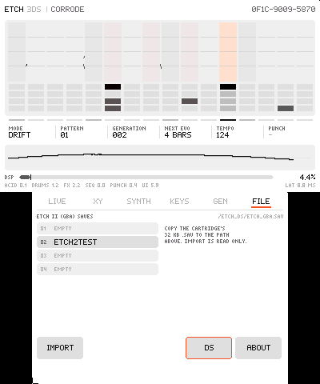

## 12. Troubleshooting

| Problem | What to do |
|---|---|
| No sound, and the title says "DSP FIRMWARE MISSING" | Run the DSP1 homebrew app once (it writes `/3ds/dspfirm.cdc`), then start ETCH 3DS again. |
| No bass | Use headphones. The speakers can't play the lowest notes. |
| "NO SD CARD" in FILE | The SD card isn't readable. Check that it's inserted, then restart ETCH 3DS. |
| An import slot says EMPTY | Check the file name and folder: `/etch_ds/etch_gb.sav` or `/etch_ds/etch_gba.sav`, the full 32 KB file. |
| The music won't change | MODE is STABLE (GEN). Set DRIFT or CORRODE. |
| The cursor won't move with the Circle Pad | That's by design: the Circle Pad is PUNCH. Move the cursor with the D-pad. |
| A tap does nothing | Touch is single-point: lift your finger between taps. |
| How do I quit? | Press SELECT + START + L + R together, or use the HOME button. |

## 13. Credits

**ETCH 3DS — by Synth Centric.** Synth Centric is Dan Schwebel, an Australian beat maker, music producer, writer and educator.

CORROSION and ETCH's oscillator recipes come from ETCH (MIT licence). Built with devkitARM and libctru; tested with the Azahar emulator. TB-303 is a trademark of Roland Corporation; ETCH 3DS is not affiliated with Roland or Nintendo. See `THIRD_PARTY_NOTICES.md` for all licences.
